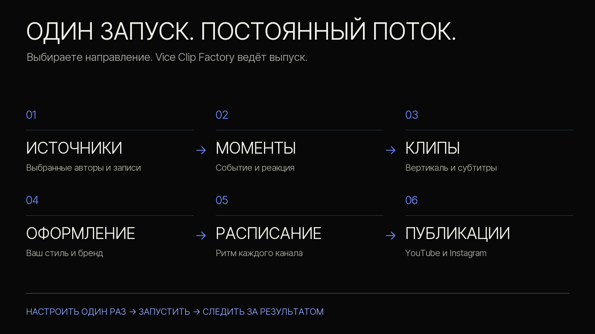
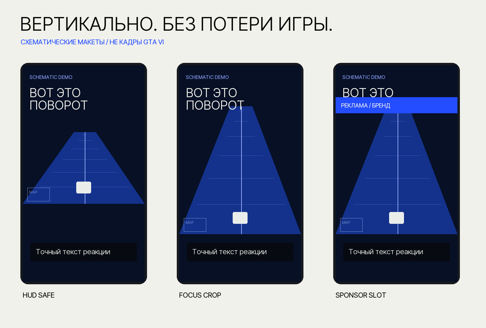

<p align="center"></p>

<p align="center"><a href="output/pdf/GTA-VI-Clip-Factory-Guide-by-Leo.pdf">Руководство пользователя</a> · <a href="docs/QUICKSTART.md">Установить</a> · <a href="sales/OFFER.md">Пакеты продукта</a> · <a href="https://github.com/leoaic0nt3nt/vice-clip-factory/releases/latest">Скачать</a></p>

# Vice Clip Factory

Наша система производства вертикальных игровых роликов для YouTube Shorts и Instagram Reels. Вы выбираете источники, оформление и каналы. Автопилот следит за новыми записями, находит кандидатов, собирает клипы и выпускает их по расписанию.

## Установить и запустить

macOS и Linux, Python 3.12 рекомендуется. Установщик ставит рабочий профиль без загрузки многогигабайтных дополнительных исходников.

```bash
curl -fsSL https://raw.githubusercontent.com/leoaic0nt3nt/vice-clip-factory/main/install.sh -o install.sh
bash install.sh
# Выполните команду активации, которую покажет установщик.
viceclip setup
viceclip autopilot start --persistent
```

В скачанном пакете достаточно `bash install.sh`. Мастер один раз попросит подключения каналов, источники, стиль и частоту выпуска. Для круглосуточной работы машина должна оставаться включённой и подключённой к интернету.

## Как работает автопилот



1. Наблюдает за выбранными YouTube/Twitch авторами и папками с видео; поиск по теме подключается отдельной настройкой.
2. Получает новую запись или ограниченный фрагмент доступной трансляции.
3. Анализирует речь, звук и движение, ранжирует моменты и отбрасывает повторы.
4. Делает вертикальные клипы с субтитрами, подписью канала и выбранным оформлением.
5. Ставит их в очередь каждого аккаунта и публикует с заданными интервалами.
6. Сохраняет прогресс, обновляет доступы и продолжает работу после перезапуска.

Обычный режим не спрашивает подтверждение для каждого клипа. Начать можно с предпросмотра, затем включить выпуск. Список источников и параметры меняются один раз в настройках. При неоднозначном ответе платформы автопилот удерживает конкретную задачу для сверки и продолжает остальные.

## YouTube и Instagram в одном процессе

Каждому каналу задаются собственные доступы, лимит и расписание. Для YouTube предусмотрена авторизация владельца через браузер. Instagram подключается через официальный доступ профессионального профиля; доставка готового MP4 в облако и получение ссылки затем выполняются автоматически. Поддерживается S3-совместимое хранилище, включая отдельное подключение своего провайдера.

[Как подготовить подключения](docs/CONNECT_ACCOUNTS.md) · [Первые шаги](docs/QUICKSTART.md)

## Оформление под ваш канал



Сохраняйте подпись, субтитры и верхнюю/нижнюю область интеграции. Плашка располагается отдельно от действия и текста. Для каждого клиента можно вести собственный профиль источников и каналов. Доступность рекламных форматов определяется подключением площадки; рекламные Instagram jobs требуют отдельного partnership flow и в текущем издателе отключены.

## Управление

```bash
viceclip autopilot status
viceclip autopilot logs
viceclip autopilot pause
viceclip autopilot resume
viceclip autopilot stop
```

`start --persistent` добавляет фоновую службу для перезапуска средствами macOS/Linux. `run` работает в открытом терминале; `tick --preview` делает один проход без загрузок. Настройки по умолчанию хранятся в `~/.viceclip/config.json`, доступы — в приватной папке рядом.

Можно поручить установку и работу Codex: откройте папку продукта и попросите установить Vice Clip Factory, подключить ваши каналы, проверить первую запись и включить автопилот. Авторизацию владельца нужно пройти самостоятельно.

## Как использовать продукт в бизнесе

- Развивать свои игровые рубрики и продавать подходящие интеграции после появления аудитории.
- Выпускать вертикальные ролики для стримеров по регулярному пакету услуг.
- Вести отдельные каналы и настройки клиентов как небольшая контент-студия.

В [руководстве](output/pdf/GTA-VI-Clip-Factory-Guide-by-Leo.pdf) разобраны установка, первый запуск, ежедневная работа, модели дохода и рост от одного канала к нескольким. Расчёты приведены как примеры; доход и охват зависят от контента, продаж и доступности монетизации.

**Стоимость продукта и запуска: по запросу.** Состав пакетов и готовые материалы — в [папке продажи](sales/OFFER.md). [Канал Лео](https://t.me/leo_ai_content).

## Проверка качества поставки

Проверены установка рабочего профиля, локальное распознавание речи, сквозной рендер, очередь, повторные проходы и восстановление. Внешние издатели и облачная доставка покрываются автоматическими тестами; подтверждённая боевая публикация требует реальных подключений владельца.

[Техническое демо, 20 секунд](output/demo/clip-demo.mp4) — синтетический тестовый вход, не gameplay GTA VI. [Результаты проверки](docs/verification.md).

## Поддержка и документация

- [Быстрый старт](docs/QUICKSTART.md)
- [Подключение аккаунтов](docs/CONNECT_ACCOUNTS.md)
- [Ответы покупателю](docs/FAQ.md)
- [Инструкция для Codex](AGENTS.md)
- [Продажа, передача и приёмка](sales/SELLER_PLAYBOOK.md)
- [Документация разработчика](docs/architecture.md), [лицензии компонентов](THIRD-PARTY.md)

Независимый продукт. Не связан с Rockstar Games. Названия и логотип GTA VI принадлежат их правообладателям и обозначают игровую тематику продукта.
