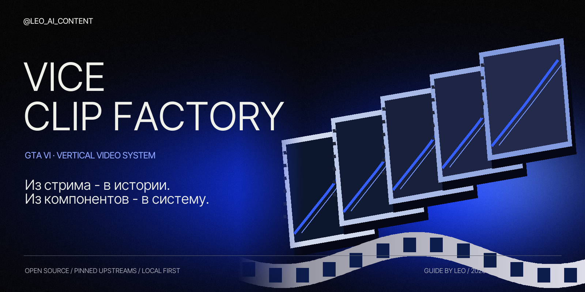

<p align="center"></p>

<p align="center">
  <a href="output/pdf/GTA-VI-Clip-Factory-Guide-by-Leo.pdf">PDF-гайд от Лео</a> ·
  <a href="MASTER_INSTRUCTION.md">Единая инструкция агенту</a> ·
  <a href="docs/setup.md">Запуск</a> ·
  <a href="docs/operations.md">Автономная работа</a> ·
  <a href="upstream.lock.json">Закреплённые исходники</a>
</p>

# Vice Clip Factory

Мегарепозиторий для вертикальных историй из игровых стримов: готовые проекты с GitHub, единое Python CLI, шаблоны оформления, очередь для нескольких YouTube/Instagram аккаунтов и практический русский гайд в стиле **@leo_ai_content**.

**Девять репозиториев действительно клонированы в `upstream/` и закреплены по SHA.** Это Git submodules: исходники получаются одной командой clone, сохраняют авторство и собственные лицензии. Вокруг них добавлен рабочий локальный конвейер. Простой путь проверяется без GPU и подключённых соцсетей; готовый игровой AI-движок подключается отдельным профилем.

## Забрать и проверить

```bash
git clone --recurse-submodules --shallow-submodules https://github.com/leoaic0nt3nt/vice-clip-factory.git
cd vice-clip-factory
python3 scripts/bootstrap.py --profile core
source .venv/bin/activate
viceclip doctor
python scripts/make_demo.py
viceclip run --input examples/demo-source.mp4 --source-id demo --config examples/config.json --transcript examples/transcript.json --top 1 --output-dir output/first-run
```

Python 3.12 рекомендуется, FFmpeg устанавливается отдельно. Результат — вертикальный MP4, ASS, план и JSON с исходными интервалами. Новые запуски пишите в новые папки. Демо синтетическое: это проверка обработки, **не кадры GTA VI**. Обычный GitHub Download ZIP не содержит submodules; используйте clone выше. Для экономии места можно начать с glue и `upstream/yt-dlp`: подробности в [setup](docs/setup.md).

[Посмотреть готовый 20-секундный технический MP4](output/demo/clip-demo.mp4) · [Кадр результата](assets/render-preview.png) · [Скачать релиз](https://github.com/leoaic0nt3nt/vice-clip-factory/releases/latest)

## Из чего собрана фабрика

| Этап | Готовый проект в мегарепозитории | Как используется |
|---|---|---|
| Получение разрешённого медиа | [yt-dlp](upstream/yt-dlp) | Рабочий download adapter для одного согласованного URL |
| Twitch discovery / EventSub | [pyTwitchAPI](upstream/twitchapi) | Исходники SDK; базовый discovery вызывает официальный Helix напрямую |
| Речь и временные метки | [WhisperX](upstream/whisperx) | Опциональный `viceclip asr`, отдельная среда |
| Границы сцен | [PySceneDetect](upstream/pyscenedetect) | Опциональный `viceclip scenes`; смена кадра помогает анализу |
| Первый монтаж по аудио/движению | [Auto-Editor](upstream/auto-editor) | Опциональный `viceclip autocut`; текущий source — Nim |
| Готовый игровой clipper | [Medusa Clip](upstream/medusa-clip) | Локальный bridge: звук + движение, опционально внешний multimodal judge |
| Наблюдение/редактор/планирование | [ClippyMe](upstream/clippyme) | Альтернативное самостоятельное приложение; его Zernio не входит в базовый publisher |
| Параметризованная React-графика | [Remotion](upstream/remotion) | Исходники для сложных шаблонов; базовый путь рендерит FFmpeg |
| Финальная сборка и кодирование | [FFmpeg](upstream/ffmpeg) | Системный бинарник для реального монтажа; исходник включён отдельно |

Базовый YouTube/Instagram publisher использует официальные HTTP API. Он не требует пароля соцсети, неофициального browser-login или платного posting gateway. Сравнение готовых проектов и причины выбора — [upstream selection](docs/upstream-selection.md). Лицензии — [THIRD-PARTY](THIRD-PARTY.md); root MIT относится к оригинальному glue, а не ко всему набору.

## От исходника к публикации


1. Scout ищет новых авторов по YouTube-запросу и Twitch-категории. Discovery отслеживает согласованных авторов; права и способ получения оригинала проверяются отдельно.
2. ASR, звук, движение и границы сцен помогают собрать кандидатов.
3. Baseline ранжирует прозрачно; Medusa добавляет готовый gameplay engine и опциональную модель.
4. FFmpeg собирает 1080×1920 с хуком, субтитрами, брендом и верхним/нижним слотом интеграции.
5. Review подтверждает историю, точность, права и авторский вклад.
6. SQLite-очередь распределяет jobs по аккаунтам, времени и лимитам; неопределённый upload блокируется до сверки.

## Два пути монтажа

**Лёгкий локальный конвейер** работает на CPU с JSON transcript. Он использует звук, движение, ключевые слова RU/EN и простые setup/payoff признаки. Сохраняет исходные интервалы, отбрасывает перекрывающиеся кандидаты и пересчитывает субтитры после разрезов. Тихий движущийся эпизод не удаляется только из-за тишины.

**Готовый игровой AI-движок** запускается из клонированного Medusa:

```bash
python3 scripts/bootstrap.py --profile medusa
.tools/medusa/bin/python scripts/run_medusa.py examples/demo-source.mp4 --config examples/config.json --source-id demo --out output/medusa --clips 1
```

Bridge по умолчанию работает без внешнего LLM и captions. `--captions` включает ASR, `--allow-cloud` — модель по вашему ключу, с возможными расходами и передачей текста/кадров. Тяжёлый профиль проверен по исходникам, его runtime в этой поставке не запускался. Баллы обоих движков помогают отбору; они не являются доказанным прогнозом охвата. Action tracking и смысловое понимание GTA в базовом CLI не реализованы.

## Вертикальный формат и интеграции


В базовом renderer весь широкий кадр сохраняется внутри вертикали. Хук и субтитры вынесены в отдельные зоны. `style.sponsor_position` выбирает top/bottom, а `sponsored` проходит через sidecar в очередь. Макеты focus crop показывают возможную редакционную подачу; интеллектуальное слежение за действием не заявляется. Подробности рекламы и ограничений — [platform research](docs/platform-research.md).

## Несколько каналов и автономный режим

В конфиге каждый канал получает отдельные credentials, ожидаемый remote ID, лимиты и расписание. YouTube поддерживает refresh token из приватного файла. Instagram требует professional account и публичный HTTPS URL конкретного MP4; подключение object storage остаётся вашим delivery adapter. Sponsored Instagram в базовом publisher заблокирован до реализации проверенного partnership flow.

```bash
# Найти новых авторов по теме (только кандидаты, без выдачи прав):
python scripts/scout_sources.py --output output/source-candidates.json

# Поиск метаданных разрешённых авторов:
viceclip discover --config config.local.json --output output/discovered.json

# Постоянная обработка локальных оригиналов партнёра:
python scripts/watch_inbox.py --inbox data/inbox --config config.local.json --source-id your-owned-source --asr

# Проверка очереди без загрузки:
viceclip queue run --config config.local.json --db data/publish.sqlite3
```

Для auto-approval нужны явный флаг и настройка приватного конфига. Реальная загрузка требует `--execute`; при подготовке проекта внешние публикации не выполнялись. Начните с review и YouTube private. Worker, OAuth, расписание, восстановление и масштабирование описаны в [инструкции эксплуатации](docs/operations.md).

## Что готово и что подключается

| Возможность | Состояние |
|---|---|
| Девять pinned upstream checkout + проверка SHA | Включено |
| Локальный analyze → plan → render | Реализовано и проверено на оригинальном fixture |
| Субтитры и консервативная обработка пауз | Реализовано, ASS + растровый fallback для FFmpeg без libass |
| Мультиаккаунтная очередь, dedup, approval, timezone | Реализовано; API проверяется mock-тестами |
| YouTube / Instagram upload adapters | Реальный код официальных API, live OAuth/upload не проверены |
| Scout новых авторов + discovery согласованных | Реальный код YouTube/Twitch API; нужны credentials, новые кандидаты всегда needs_rights |
| WhisperX / PySceneDetect / Auto-Editor | Опциональные CLI adapters, зависят от установки upstream |
| Medusa local bridge | Source-reviewed; ML runtime не запускался |
| Непрерывный локальный inbox | Worker включён; автоочередь YouTube, Instagram delivery отдельно |
| Near-live chunk ingest, semantic dedup, analytics learning | План развития в [architecture](docs/architecture.md) |

## Проверки и документация

```bash
python -m unittest discover -s tests -v
python scripts/verify_upstream.py
```

- [Единая большая инструкция агенту](MASTER_INSTRUCTION.md)
- [Запуск, модели и OAuth](docs/setup.md)
- [Worker, расписание и восстановление](docs/operations.md)
- [Архитектура и следующие этапы](docs/architecture.md)
- [Разбор двух референсов](docs/reference-analysis.md)
- [Проверенные источники и ограничения платформ](docs/platform-research.md)
- [Результаты проверки поставки](docs/verification.md)
- [PDF-гайд](output/pdf/GTA-VI-Clip-Factory-Guide-by-Leo.pdf) и [его текст](docs/GUIDE.md)

Проверка источников: **16 ноября 2026**. Официальная дата GTA VI на момент проверки — **19 ноября 2026**, поэтому демо не использует «готовый GTA VI gameplay». Использование чужого стрима, коммерческие права издателя, музыка и доступность платформенной монетизации проверяются независимо. Подрезка и субтитры сами по себе не гарантируют принятие в монетизацию. Детали и первичные ссылки собраны в исследовании.

<p align="center"><a href="https://t.me/leo_ai_content">Лео · @leo_ai_content</a></p>
