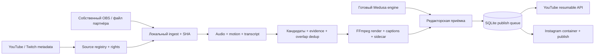

# Архитектура и развитие

## Текущая поставка

Базовая среда: Python CLI + Pillow + системный FFmpeg. JSON - конфигурация и промежуточные артефакты, SQLite - локальная очередь. Сложные модели живут в отдельных средах. Никакие API keys не требуются для smoke test.

### Кто владеет этапом

- `src/viceclip/integrations.py`: запускает готовые upstream CLI и получает metadata discovery через официальные API.
- `media.py`: ffprobe, fingerprint, признаки audio/motion и чтение transcript.
- `scoring.py`: детерминированный baseline, overlap suppression и пересчёт временных меток.
- `render.py`: исходные диапазоны -> портретный мастер, текст/бренд/интеграция, sidecar.
- `rights.py`: source allowlist и разрешения.
- `queue.py`: транзакции, уникальность, согласование и состояние каждой загрузки.
- `publishers.py`: HTTP API, credentials, предварительные проверки и сохранение remote progress.
- `scripts/run_medusa.py`: узкий мост к готовому игровому движку, отдельная среда и явный cloud opt-in.
- `scripts/watch_inbox.py`: постоянный локальный процесс для поступающих файлов, журнал по SHA и очередь YouTube.

Части не объявляются автоматически интегрированными лишь потому, что source клонирован. Remotion, TwitchAPI SDK и ClippyMe включены как готовые самостоятельные основы; текущие CLI discovery/publishing используют тонкие прямые адаптеры официальных API. Нет зависимости от внешнего платного posting gateway.

## Контракты артефактов

`analysis.json`: fingerprint входа, параметры медиа, признаки по времени. `plan.json`: source ID, analysis, transcript, кандидаты и их evidence. `clip-NN.mp4`: конечный мастер. Соседние `.ass` и `.json`: субтитры, сохранённые source ranges, hash выхода, sponsor flag и причины выбора.

База очереди приватная. Её уникальность по output hash/account/platform предотвращает повтор одного и того же файла на том же аккаунте; новый encode изменяет hash. Это не семантическая защита от повторов события. Права и hash файла повторно проверяются перед побочным эффектом. Токены не входят в metadata и журнал общего доступа.

## Почему базовый отбор ограничен

Смена кадра часто означает движение камеры, звук может быть музыкой, ключевые слова могут относиться к другому событию. Их комбинация полезна для сортировки, но не доказывает наличие истории. Baseline учитывает 40% словарных маркеров, по 20% аудио, движения и примитивной setup/payoff структуры. Веса - стартовая эвристика, не обученная модель GTA VI.

Medusa добавляет более подходящий готовый gameplay workflow, но требует отдельного smoke test на ваших записях. Его model score тоже нуждается в оценке человеком. Для проверки подготовьте набор разрешённых эпизодов: погоня, fail, редкая ситуация, тихий setup, длинная пауза, громкая музыка без события, речь без payoff, переход меню, сюжетный спойлер. Замерьте precision пригодных top-N, сохранение context/payoff, долю ложных дублей и затраты review.

## Этапы после локального пилота

| Этап | Что сделать | Проверяемый критерий |
|---|---|---|
| 1. Свои реальные исходники | Один источник, один язык, один канал, 20-30 ручных проверок | Каждый выбранный эпизод понятен и содержит payoff; есть права и provenance |
| 2. Аккаунты | OAuth каждого канала, private upload, IG container на своём профиле | Целевой ID совпадает, обработка закончилась, владелец реально видит видео |
| 3. Storage delivery | Immutable объект по SHA, HTTPS URL, retention и revocation | Meta получает именно утверждённые байты, private credentials не утекли |
| 4. AI gameplay | Medusa на реальных эпизодах, model routing и бюджет | Уместные top-N лучше baseline на согласованном тест-наборе |
| 5. Near-live | OBS/партнёрский разрешённый feed, chunks, overlap, watermark | Замерена end-to-end latency; стыки не обрывают историю и не дублируются |
| 6. Флот каналов | Account partition, project quota budget, consent, alarms | Ошибка одного аккаунта не останавливает остальные; нет потерянных/двойных jobs |
| 7. Аналитика | Данные каждого владельца, редакционные A/B гипотезы | Улучшение удержания проверено серией; нет недопустимой агрегации API data |

## Дальнейшие инженерные задачи

- Подключить официальный Twitch clip download flow для broadcaster/editor с нужными scopes; metadata endpoint сам не отдаёт произвольный VOD.
- Сделать полноценный resumable reconcile/retry по сохранённой YouTube session; в MVP после неоднозначного исхода требуется оператор.
- Подключить разрешённый Instagram partnership label flow до sponsored публикаций для подходящих юрисдикций.
- Добавить perceptual/video fingerprint, а затем semantic dedup между изменёнными роликами и каналами.
- Для большой нагрузки заменить локальный worker транзакционными leases и broker; SQLite baseline предназначен для небольшого пилота.
- При необходимости сделать Remotion template plugin, реализовать action-aware reframe и проверить его на HUD/crosshair fixtures.
- Разделить rendering, provider acceptance, processing and playback probes в наблюдаемости.

Это список развития, а не заявление о готовых функциях. Конвейер не получает права на чужие стримы, доступ к API и монетизацию через установку зависимостей.
